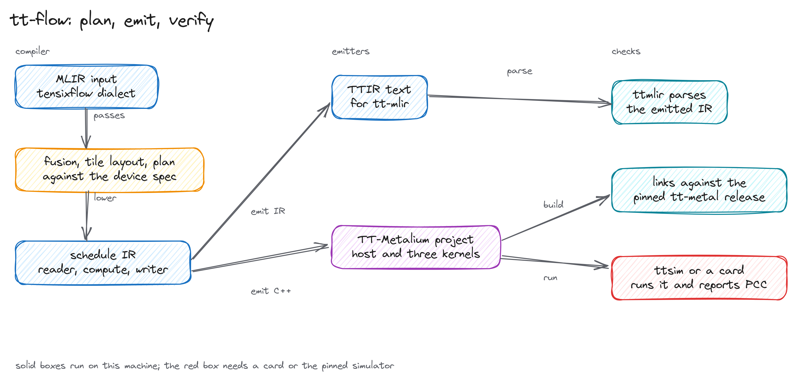
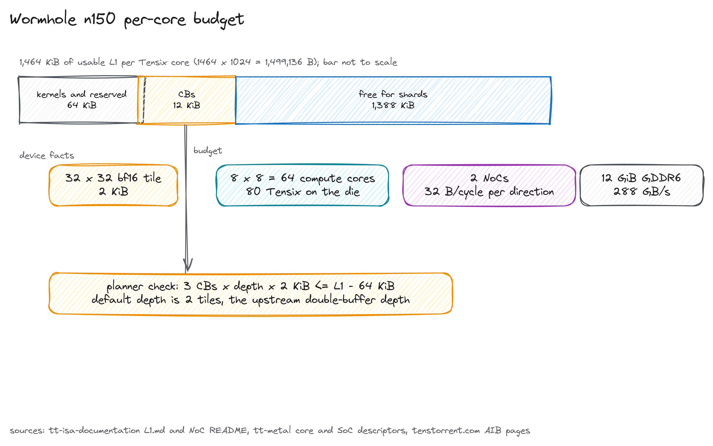
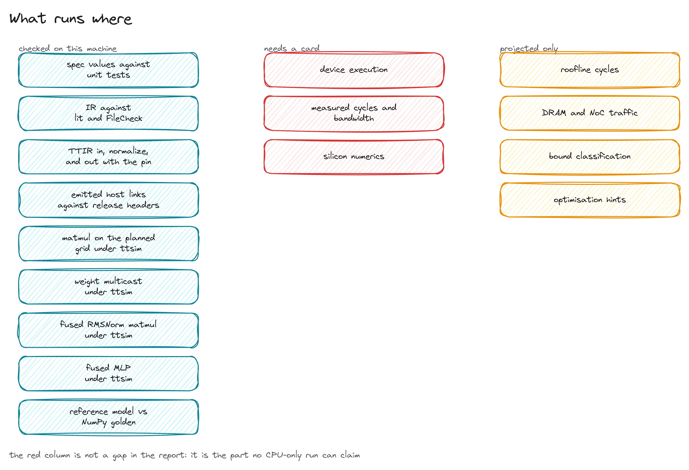

# tt-flow

A compiler and device-cost planner for fused transformer kernels on Tenstorrent hardware.
It reads MLIR, fuses RMSNorm+MatMul and MLP chains, plans the core grid and circular buffers
against published device limits, reports a projected cost, and emits a TT-Metalium project that
builds against a pinned upstream release and runs on the real grid.

The point is to answer two questions before you write a kernel: does the fused op fit on the
card, and what does the schedule cost in bytes and projected cycles. With no card in the
machine, the emitted program still runs on Tenstorrent's official simulator.



## What it does

The compiler takes MLIR written in its own dialect or a documented bare-tensor TTIR subset,
runs fusion and tile-layout inference, plans a core grid and circular-buffer allocation for a
named device, and reports a projected roofline. It can stop at a plan, emit TTIR text for
tt-mlir, or emit a TT-Metalium project with a host program and three kernels.

Build it first:

```sh
devenv shell -- bash scripts/build.sh
```

Plan the fused RMSNorm+MatMul example on a Wormhole n150:

```sh
devenv shell -- build/bin/tensixflow-opt \
  --tensixflow-device=n150 \
  --tensixflow-infer-tile-layout \
  --tensixflow-fuse-rmsnorm-matmul \
  --tensixflow-plan-noc-sharding \
  examples/rmsnorm_matmul.mlir
```

The pass prints the device it planned against, the grid, weight strategy, circular-buffer
footprint, and projected traffic for the unfused and fused paths. An upstream TTIR module enters
the same pipeline:

```sh
devenv shell -- build/bin/tensixflow-opt \
  --allow-unregistered-dialect \
  --tensixflow-import-ttir \
  --tensixflow-infer-tile-layout \
  --tensixflow-plan-noc-sharding \
  examples/ttir/rmsnorm_matmul.mlir
```

The default device is n150; n300, p100a, and p150a are accepted too. Every figure in the output
comes from the published device data in `spec/devices.json`.

Layout-encoded TTIR, including the text the emitter prints, goes through the normalizer first:

```sh
devenv shell -- bash scripts/normalize_ttir.sh layout.mlir -o bare.mlir
devenv shell -- build/bin/tensixflow-opt --allow-unregistered-dialect \
  --tensixflow-import-ttir --tensixflow-plan-noc-sharding bare.mlir
```

The normalizer parses with the pinned tt-mlir bindings, drops the layout encodings and device
attributes the importer does not link, and leaves the function bodies and semantic attributes
unchanged.

## Devices

| Device | Architecture | Compute grid | L1 per core | DRAM |
|---|---|---|---|---|
| n150 | Wormhole B0 | 8x8 | 1,499,136 B | 12 GiB at 288 GB/s |
| n300 | 2 x Wormhole B0 | 8x7 per chip | 1,499,136 B per chip | 24 GiB at 576 GB/s |
| p100a | Blackhole | 12x10 | 1,572,864 B | 28 GiB at 448 GB/s |
| p150a | Blackhole | 12x10 | 1,572,864 B | 32 GiB at 512 GB/s |

Tenstorrent's product pages list 120 Tensix cores for the Blackhole cards while the die has 140
workers and the unharvested descriptor has a 13x10 grid. The repository records all three
numbers in the device data and models the 120-core product figure. Cost figures are projected,
never measured.



## Emit and run a project

Emission realizes the planned grid. The host splits the output tiles into contiguous ranges
over the device grid, creates the three kernels on the whole range, and sets per-core start and
count arguments. The emitted project builds against the official tt-metal release recorded in
`deps/tt-metal.lock`:

```sh
devenv shell -- bash scripts/fetch_tt_metal.sh                     # pinned headers, runtime, and ttsim
devenv shell -- bash scripts/build_generated.sh examples/matmul.mlir
devenv shell -- bash scripts/run_generated.sh build-generated/matmul
```

The build script is a real gate: it configures with `find_package(TT-Metalium)` from the
extracted release package, then compiles and links the emitted host program against
`libtt_metal.so`. The run script reports the program's own PCC against its CPU reference.
Runs recorded on this machine, with no card:

| Example | Shape | Grid use | PCC |
|---|---|---|---|
| `examples/matmul.mlir` | 256x512x1024 bf16 | 64 of 64 cores, 2D blocks | 0.9890072 |
| `examples/matmul_padded.mlir` | 100x50x100 bf16, padded to tiles | 16 of 64 cores | 0.9999824 |
| `examples/matmul_small.mlir` | 128x128 output, K=64, bf16 | 16 of 64 cores | 0.999301 |
| `examples/rmsnorm_matmul_small.mlir` | 128x256 output, K=128, bf16, fused RMSNorm | 32 of 64 cores | 0.9993997 |
| `examples/mlp_block_small.mlir` | 128x128x128x128 bf16, full fused MLP | 16 of 64 cores | 0.999981 |

The matmul path uses the `blocked-reuse` mapping when the core's resident blocks fit L1: each
core stages its activation row block and weight column block once, and the weight column block
is multicast down the grid's row blocks. The activation row block is still read once per column
block, so activation replication remains. A fused RMSNorm graph is emitted when its activation
staging fits the per-core L1 budget; the plan JSON records that check as `fused_feasible` and
the emitter refuses an infeasible plan with the tile arithmetic in the message. The full MLP
chain is emitted the same way: RMSNorm, the first matmul with bias and GELU, the second matmul,
and the residual add run in one kernel, with the GELU output held in L1 between the matmuls.
The plan reports both the strategy projection and the projection of the emitted access pattern.

`scripts/run_generated.sh --device` runs the same program on a card. The device path is written
against the pinned release and has not been executed on silicon.

## What runs where



`devenv shell -- bash scripts/test.sh` checks the device data against its sources, runs the lit
and GoogleTest suites, runs the Python reference checks and the TTIR parser gate, enforces the
prose rules, and emits, compiles, and runs every emittable example under ttsim when `.deps` is
present. The simulator runs are the execution checks available without a card; device execution
and measured performance stay untested.

## Status

The emitted matmul and fused RMSNorm programs are compiled, linked, and executed on the pinned
simulator, on the plan grid and on a partial grid. The upstream matmul example from the same
release also ran under the simulator, at PCC 0.9791022. No kernel from this project has run on
Tenstorrent hardware.

Current limits, stated plainly:

- Weight multicast and reuse are emitted; activation multicast is not, so the activation row
  block is read once per used column block and the emitted-path traffic stays above the
  strategy projection by that replication.
- Fused emission is limited to shapes whose L1 staging fits the per-core budget. The large
  `examples/mlp_block.mlir` is analysis-only and is rejected with the intermediate and total
  tile counts; the MLP emitter keeps the first weight block resident on every used core and
  reads the second per row block, so MLP weight traffic is not yet multicast.
- Cost figures are a roofline projection. Nothing in this repository measures device time.
- The reference model checks the compiler's schedule semantics against a NumPy golden. It is not
  a model of the device.
